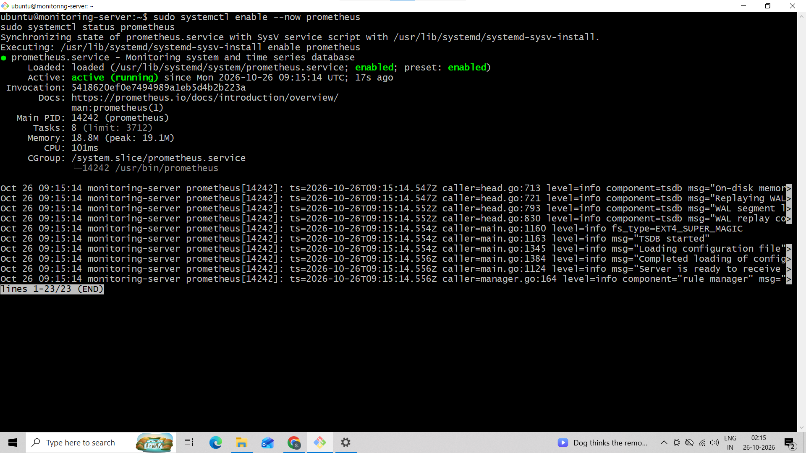
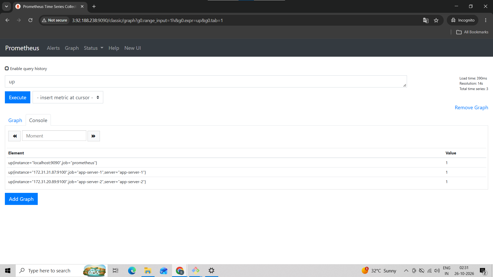
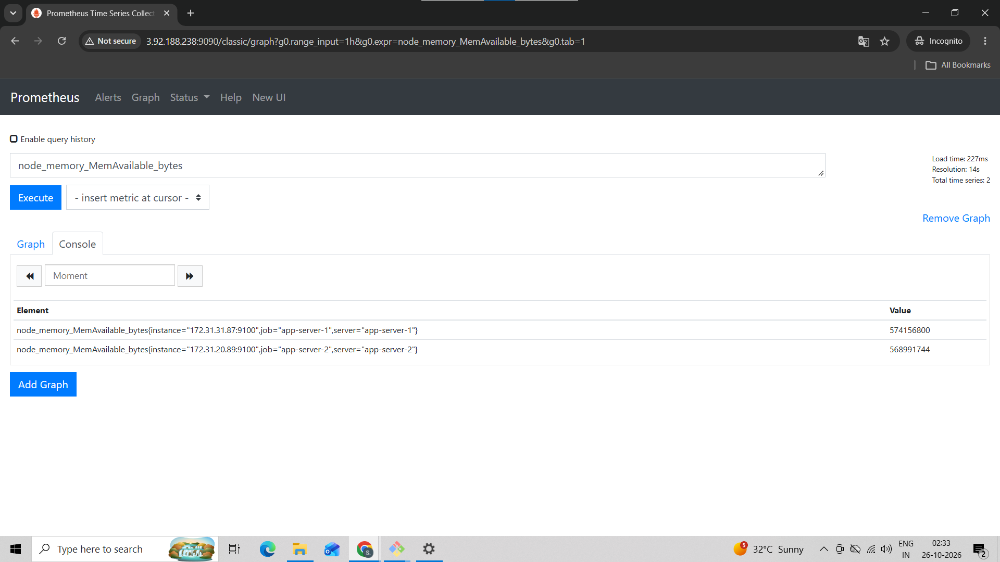
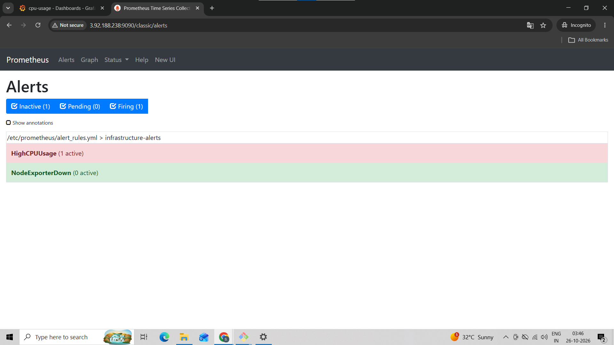

# prometheus-grafana
# Real-Time Infrastructure Monitoring and Alerting Using Prometheus and Grafana on AWS EC2

## 📌 Project Overview

This project implements a centralized infrastructure monitoring and alerting system using AWS EC2, Prometheus, Node Exporter, and Grafana.

The system collects performance metrics from multiple Linux-based EC2 instances, visualizes them through Grafana dashboards, and evaluates alerting rules to identify high CPU utilization and unavailable monitoring targets.

The project demonstrates practical skills in cloud infrastructure, Linux administration, monitoring, metrics visualization, and alert configuration.

## 🎯 Objectives

- Monitor multiple EC2 instances from a centralized monitoring server.
- Collect Linux system metrics using Node Exporter.
- Visualize CPU, memory, disk, and server availability.
- Configure Prometheus alerting rules.
- Test alert behavior under high CPU load and simulated target failure.
- Develop practical AWS Cloud and DevOps skills.

## 🏗️ Architecture

The project uses three EC2 instances.

### 1. Monitoring Server
- AWS EC2 running Ubuntu Linux
- Prometheus for metric collection and alert evaluation
- Grafana for dashboards and visualization

### 2. Application Server 1
- AWS EC2 running Ubuntu Linux
- Node Exporter exposing system metrics

### 3. Application Server 2
- AWS EC2 running Ubuntu Linux
- Node Exporter exposing system metrics

### Monitoring Workflow

1. Node Exporter collects Linux system metrics from each application server.
2. Prometheus scrapes metrics from both servers at configured intervals.
3. PromQL queries calculate resource utilization and server availability.
4. Prometheus evaluates alerting rules.
5. Grafana displays the collected metrics in monitoring dashboards.

## 🛠️ Technologies Used

| Technology | Purpose |
|---|---|
| AWS EC2 | Hosting monitoring and application servers |
| Ubuntu Linux | Server operating system |
| Prometheus | Metrics collection and alert evaluation |
| Node Exporter | Linux system metrics exporter |
| Grafana | Monitoring dashboards and visualization |
| PromQL | Metrics queries and calculations |
| YAML | Monitoring and alert-rule configuration |
| systemd | Managing Linux services |
| Git and GitHub | Version control and project documentation |

## 📊 Features

- Centralized monitoring of multiple EC2 instances
- CPU utilization monitoring
- Memory utilization monitoring
- Root filesystem utilization monitoring
- Server availability monitoring
- Grafana dashboards with real-time metric visualization
- Custom CPU utilization alert
- Monitoring-target availability alert
- CPU-load and service-failure testing

## ⚙️ Prerequisites

Before starting, ensure you have:

- An AWS account
- Three Ubuntu EC2 instances
- SSH access to the instances
- Appropriate EC2 security groups
- Private network connectivity between the monitoring and application servers
- Basic knowledge of Linux commands

Instance sizes can be selected according to workload and budget.

## 🚀 Deployment Steps

### Step 1: Launch EC2 Instances

Create three Ubuntu EC2 instances:

- `monitoring-server`
- `app-server-1`
- `app-server-2`

Use the same AWS Region and VPC to simplify private network communication.

Record the private IP addresses of both application servers.

### Step 2: Configure Security Groups

Configure inbound rules according to the deployment requirements.

| Port | Purpose | Recommended Access |
|---|---|---|
| 22 | SSH | Your trusted public IP |
| 3000 | Grafana | Your trusted public IP or VPN |
| 9090 | Prometheus | Your trusted public IP or VPN |
| 9100 | Node Exporter | Monitoring server security group |

Restrict access to monitoring interfaces and metrics endpoints. Avoid exposing these services publicly without appropriate access controls.

### Step 3: Install Prometheus

On the monitoring server:

```bash
sudo apt update
sudo apt install -y prometheus
sudo systemctl enable --now prometheus
```

Verify the service:

```bash
sudo systemctl status prometheus
prometheus --version
```

### Step 4: Install Node Exporter

Repeat these steps on both application servers.

```bash
sudo apt update
sudo apt install -y prometheus-node-exporter
sudo systemctl enable --now prometheus-node-exporter
```

Verify the service and metrics endpoint:

```bash
sudo systemctl status prometheus-node-exporter
curl http://localhost:9100/metrics
```

The Ubuntu package uses the service name `prometheus-node-exporter`. If you install Node Exporter manually, configure its service accordingly.

### Step 5: Configure Prometheus Targets

Edit the Prometheus configuration:

```bash
sudo nano /etc/prometheus/prometheus.yml
```


Replace the example placeholders with the actual private IP addresses.

Validate and restart Prometheus:

```bash
sudo promtool check config /etc/prometheus/prometheus.yml
sudo systemctl restart prometheus
sudo systemctl status prometheus
```

### Step 6: Verify Targets

Open the Prometheus targets page:

```text
http://MONITORING_SERVER_IP:9090/targets
```

Confirm that both application-server targets show `UP`.

### Step 7: Install Grafana

Add the official Grafana APT repository and install Grafana by following the instructions in the official documentation:

https://grafana.com/docs/grafana/latest/setup-grafana/installation/debian/

Enable and start the service:

```bash
sudo systemctl enable --now grafana-server
sudo systemctl status grafana-server
```

Open Grafana:

```text
http://MONITORING_SERVER_IP:3000
```

Sign in using the configured administrator credentials and change any default password.

### Step 8: Connect Grafana to Prometheus

1. Open Grafana.
2. Navigate to Connections and Data Sources.
3. Add a Prometheus data source.
4. Set the URL to `http://localhost:9090` if Grafana and Prometheus run on the same server.
5. Save and test the connection.

### Step 9: Create the Monitoring Dashboard

Create Grafana panels using PromQL queries.

#### CPU Utilization

```promql
100 * (1 - avg by (instance, server) (
  rate(node_cpu_seconds_total{
    mode="idle",
    job=~"app-server-.*"
  }[5m])
))
```

#### Memory Utilization

```promql
100 * (1 - (
  node_memory_MemAvailable_bytes{job=~"app-server-.*"}
  /
  node_memory_MemTotal_bytes{job=~"app-server-.*"}
))
```

#### Root Filesystem Utilization

```promql
100 * (1 - (
  node_filesystem_avail_bytes{
    job=~"app-server-.*",
    mountpoint="/",
    fstype!~"tmpfs|overlay"
  }
  /
  node_filesystem_size_bytes{
    job=~"app-server-.*",
    mountpoint="/",
    fstype!~"tmpfs|overlay"
  }
))
```

#### Server Availability

```promql
up{job=~"app-server-.*"}
```

Configure appropriate units, legends, and refresh intervals for each panel.

### Step 10: Configure Alerting Rules

Create an alert rules file on the monitoring server:

```bash
sudo nano /etc/prometheus/alert_rules.yml
```


Reference the file in the Prometheus configuration:

```yaml
rule_files:
  - "/etc/prometheus/alert_rules.yml"
```

Validate the rules and restart Prometheus:

```bash
sudo promtool check rules /etc/prometheus/alert_rules.yml
sudo promtool check config /etc/prometheus/prometheus.yml
sudo systemctl restart prometheus
```

Open the Prometheus alerts page to observe the alert states.

**Note:** These rules evaluate alerts within Prometheus. Sending notifications by email or other channels requires an additional notification configuration, such as Alertmanager.

## 🧪 Testing

### Test 1: CPU Utilization

Install `stress-ng` on an application server:

```bash
sudo apt update
sudo apt install -y stress-ng
```

Generate temporary CPU load:

```bash
stress-ng --cpu 2 --cpu-load 90 --timeout 300s
```

Observe the CPU panel and verify whether the `HighCPUUsage` rule enters the firing state.

The result depends on the instance capacity and actual CPU utilization.

### Test 2: Monitoring-Target Failure

Stop Node Exporter on an application server:

```bash
sudo systemctl stop prometheus-node-exporter
```

Wait for the configured alert duration and check the Prometheus alerts page.

Restore monitoring afterward:

```bash
sudo systemctl start prometheus-node-exporter
sudo systemctl status prometheus-node-exporter
```

Verify that the target returns to `UP`.


## 📸 Screenshots


### Prometheus targets showing monitored servers


### Grafana infrastructure dashboard


### CPU utilization graph


### EC2 Instances


### CPU alert in the firing state



```

## 🎓 Learning Outcomes

Through this project, I developed practical experience in:

- AWS EC2 provisioning and security groups
- Linux system administration
- Prometheus installation and configuration
- Node Exporter metrics collection
- Grafana dashboards and data sources
- PromQL queries
- Prometheus alerting rules
- Troubleshooting monitoring connectivity
- GitHub documentation and version control

## 🔮 Future Enhancements

- Configure Alertmanager for email notifications.
- Add memory and disk-space alerts.
- Automate deployment using Ansible.
- Provision infrastructure using Terraform.
- Extend monitoring to additional EC2 instances.
- Introduce secure access through VPN or a reverse proxy.

## 👨‍💻 Author

**Sumit Kamble**

- **GitHub:** [sumitk-Cloud](https://github.com/sumitk-Cloud/)
- **LinkedIn:** [Sumit Kamble](https://linkedin.com/in/sumit-kamble-a6a3b5405)
- **Email:** [sumitkamble5550@gmail.com](mailto:sumitkamble5550@gmail.com)


---

If you find this project useful, consider giving the repository a star.
